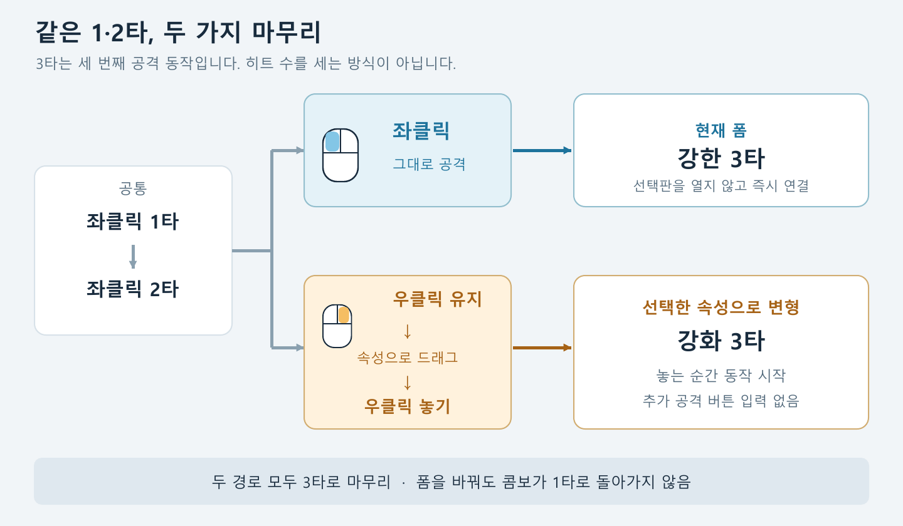
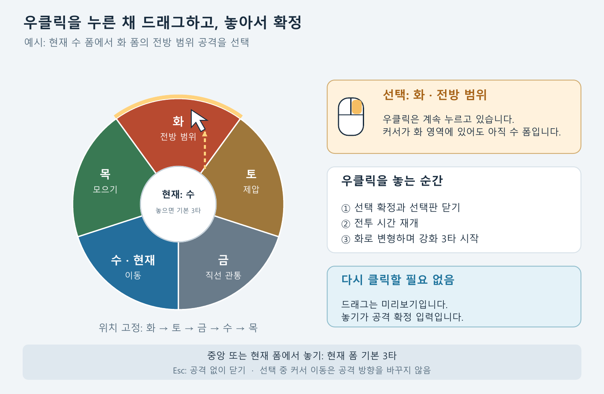
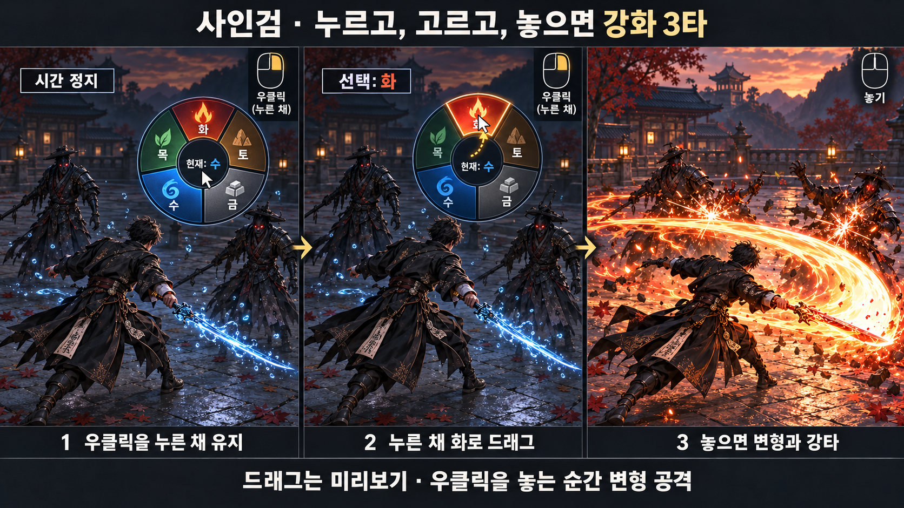

# 사인검: 드래그 선택형 변형 3타

v0.3 · 2026-10-24 · 사용자 승인본

**좌클릭 3타는 현재 폼의 강한 공격. 우클릭을 누른 채 속성으로 드래그하고 놓으면 해당 폼으로 변형하며 강화 3타.**

- [구현 전달용 기획서](docs/finisher-design.md)
- [그림 포함 PDF](output/pdf/saingeom-finisher-design-v0.3.pdf)
- [게시 정보](PUBLISHING.md)

## 입력 흐름

## 선택판

## 전투 연출 예시

두 도식은 정확한 입력 설명을 위해 코드로 그렸고, 전투 연출은 내장 image_gen 도구로 제작했습니다. 생성 프롬프트는 [여기](prompts/storyboard-prompt.txt)에 있습니다.

이 버전은 앞선 회피 전환·좌우 인접 폼·독립 전환기 안을 대체합니다. 이전 v0.1·v0.2의 문서·그림은 별도 폴더에 보존되어 있습니다. 특히 이전 토 바위막은 이 버전의 제압형 막타와 다릅니다.

피해 1.15배 등의 수치는 첫 시험용 제안입니다. 게임 구현과 플레이 검증은 아직 하지 않았습니다. 사용자 승인에 따라 기존 `lala11112/Four-Tiger-Sword` 저장소의 `docs/elemental-finisher` 브랜치에 게시했습니다. 기획 본문과 PDF는 승인받은 원문을 보존했으며, 그 안의 게시 전 상태 문구는 제작 당시의 기록입니다.

