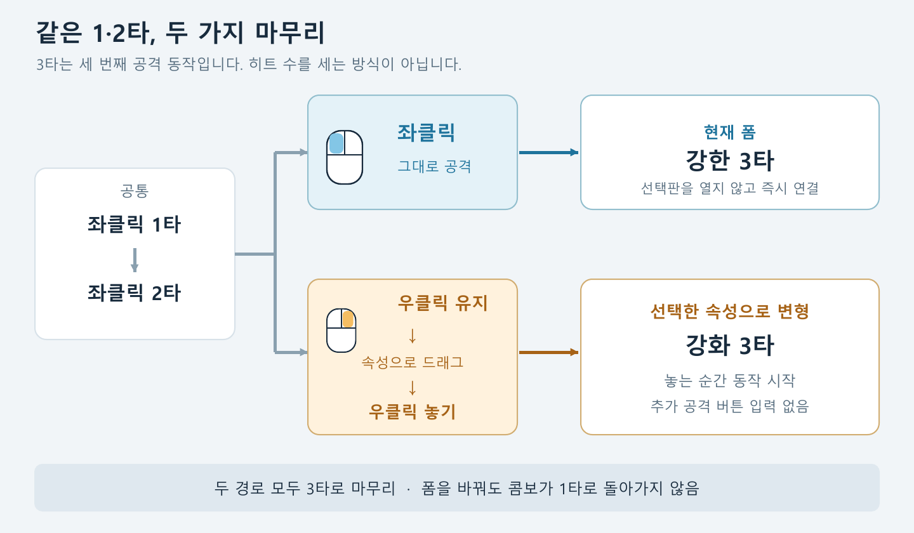
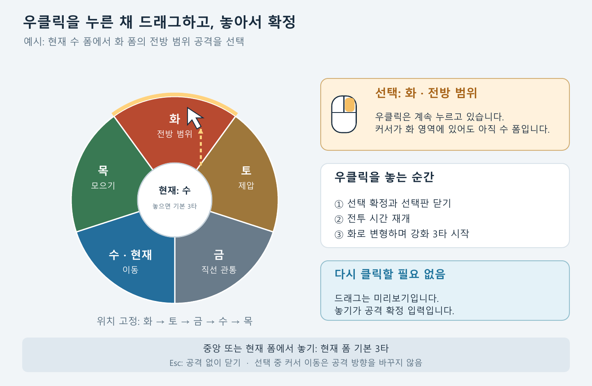
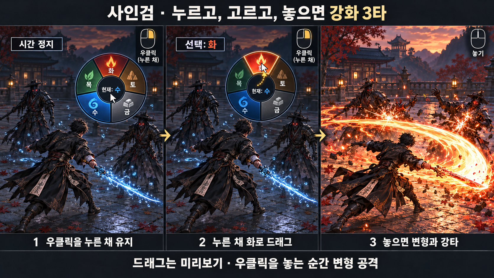

# 사인검: 드래그 선택형 변형 3타
## 구현 전달용 기획서 v0.3

2026-10-24 · 사용자 지정 조작 반영 · 최종 검토용

**좌클릭 3타는 현재 폼의 강한 공격. 우클릭을 누른 채 속성으로 드래그하고 놓으면, 그 폼으로 변형하며 강화 3타.**

### 핵심 동작

- 좌클릭으로 1·2타를 공격한 뒤, 좌클릭을 이어 누르면 현재 폼의 강한 3타가 나간다.
- 같은 3타 연결 시점에 우클릭을 누르고 유지하면 시간이 멈추며 폼 선택판이 열린다.
- 우클릭을 계속 누른 채 원하는 속성 영역으로 커서를 드래그한다.
- 우클릭을 놓으면 선택한 폼으로 변형하면서 그 속성의 강화 3타를 시작한다. 공격 버튼을 다시 누르지 않는다.
- 변형해도 콤보는 1타로 돌아가지 않는다. 막타 뒤에는 선택한 폼을 현재 폼으로 유지한다.

**용어:** 이 문서의 1·2·3타는 공격 입력에 따른 콤보 단계다. 한 동작 안의 다중 히트 수와 구분한다. 그림은 조작·연출 설명용이며 실제 게임 화면이나 확정 에셋은 아니다.

<!-- pagebreak -->

# 1. 선택판: 누르기, 드래그, 놓기

### 고정 배치

위쪽 화에서 시계 방향으로 **화 → 토 → 금 → 수 → 목**을 배치한다. 배치 순서는 구현 초안이며, 어떤 폼을 들고 있어도 위치를 회전시키지 않는다. 속성 색과 함께 역할 이름·아이콘을 표시한다.

| 입력 또는 위치 | 처리 |
| --- | --- |
| 다른 속성 영역 위로 드래그 | 해당 영역만 강조. 폼·스탯·피해는 아직 바뀌지 않음 |
| 다른 속성 영역에서 우클릭 놓기 | 해당 폼으로 변경하고 강화 3타 시작 |
| 중앙 또는 현재 폼 영역에서 놓기 | 폼 변경 없이 현재 폼의 기본 3타 시작 |
| Esc / 포커스 상실 / 상태 무효 | 공격 없이 닫기. 원래 폼 유지 |

열 때 선택 커서는 중앙에서 시작한다. 중앙에는 현재 폼과 기본 3타 안내를 표시한다. 판정은 UI 그림의 틈이나 충돌 영역이 아닌 중앙 대비 커서의 거리·각도로 계산하며, 미리보기와 확정에 같은 판정을 사용한다. 판 바깥으로 드래그해도 방향 선택을 유지한다.

초기 UI 기준은 바깥 반경 250, 중앙 반경 90 논리 단위이며 해상도에 따라 함께 확대한다. 중앙 반경 미만은 기본 3타다. 화의 중심은 12시이고 각 영역은 72도다. 정확히 경계각이면 시계 방향 다음 영역에 포함한다. 놓는 프레임의 누적 마우스 이동으로 최종 선택을 갱신한다.

<!-- pagebreak -->

# 2. 전투 장면에서 보이는 흐름

### 수 폼에서 화 폼으로 끝내는 예시

1. 수 폼의 2타가 끝나고 3타를 연결할 순간이 된다.
2. 우클릭을 누른다. 플레이어·적·날아가는 공격의 전투 시간이 정지하고, 선택판과 커서가 나타난다.
3. 버튼을 누른 채 커서를 화로 옮긴다. 화 영역이 강조되지만 무기는 여전히 수 폼이다.
4. 버튼을 놓는다. 선택판이 닫히고 시간이 재개되며, 무기가 화로 변하면서 큰 반원 베기를 시작한다.
5. 실제 피해는 강화 3타 애니메이션의 타격 시점에 발생한다. 놓는 프레임에 보이지 않는 피해부터 지급하지 않는다.

### 애니메이션과 입력의 약속

**2타 회복 → 선택 대기 → 변형 3타 시작 → 타격 판정 → 마무리 회복**

선택 중에는 2타 회복 자세를 유지한다. 확정 이후 몸의 회전과 무기 형태 변화가 3타 동작으로 이어지게 한다. 기본 3타와 강화 3타 모두 마무리 동작이며, 강화 3타 뒤에 기본 3타나 별도의 네 번째 공격을 자동으로 덧붙이지 않는다.

드래그는 속성 선택이다. 캐릭터가 공격할 방향은 선택판을 열 때 고정하고, 커서를 드래그했다고 카메라나 캐릭터가 다른 방향으로 돌아가지 않게 한다. 초안은 조준을 함께 바꾸는 기능을 포함하지 않는다.

<!-- pagebreak -->

# 3. 속성별 강화 3타

각 폼은 명확한 역할 하나를 담당한다. 적의 위치와 상태를 보고 필요한 공격을 선택한다.

| 폼 | 강화 3타 | 고르는 상황 |
| --- | --- | --- |
| 화 | 전방 반원으로 넓게 쓸어 베기 | 앞쪽에 퍼진 여러 적에게 마무리 피해 |
| 토 | 무겁게 내려쳐 짧게 제압 | 가까운 적의 행동을 끊거나 버티는 적 압박 |
| 금 | 긴 직선으로 관통 찌르기 | 거리가 벌어진 적 또는 일렬의 적 공격 |
| 목 | 전방의 적을 끌어모으며 베기 | 다음 공격을 여러 적에게 함께 연결 |
| 수 | 옆이나 뒤로 이동하며 베기 | 반격을 피하거나 자리를 바꾸며 마무리 |

### 강한 기본 3타와 더 강한 변형 3타

좌클릭 기본 3타도 기존 폼의 강한 마무리로 설계한다. 다른 폼으로 변형한 3타는 그 폼의 일반 3타보다 강화된 피해와 해당 속성의 역할을 제공한다.

첫 피해 시험값은 **변형 3타 = 선택한 폼의 일반 3타 기준 피해 합계 × 1.15**를 제안한다. 이 15%는 사용자 확정 수치가 아니며 실제 플레이 전의 조정 출발점이다. 기준 피해는 한 동작의 전체 타격 합계이고, 실제 지급 횟수는 해당 3타의 설계에 따른다. 기존 적중 이벤트와 새 강화 판정을 이중 적용하지 않는다.

중앙이나 현재 폼 영역 선택은 기본 3타이며 변형 보너스가 없다. 변형 때문에 이미 끝난 1·2타의 피해를 다시 지급하지 않는다. 강화 배율로 일반 3타를 선택할 이유가 사라지는지는 실제 전투에서 비교한다.

### 역할별 구현 경계

- 화는 반원 범위의 한 마무리다. 별도 폭발·화상·불장판까지 자동 추가하지 않는다.
- 토의 CC는 일반 적과 보스의 기존 경직·무력화 규칙을 따른다. 무조건 기절시키는 규칙이 아니다. CC 담당을 토로 두는 것은 앞선 논의 기준의 배정안이다.
- 금의 긴 판정은 벽에서 멈춘다. 방어 무시·순간이동을 자동 부여하지 않는다.
- 목은 벽·낭떠러지·대상 충돌과 이동 면역을 존중한다. 보스에게 강제 끌어오기까지 보장하지 않는다.
- 수는 실제 위치 이동으로 공격선을 피한다. 기존 대시 무적을 자동 상속하지 않는다. 이동 방향 세부 입력은 후속 조정 항목이다.

새 충전 게이지·오행 표식·정해진 순환 보너스·기존 v0.1의 공통 1.2초 제한은 넣지 않는다.

<!-- pagebreak -->

# 4. 구현자가 지켜야 할 입력과 시간 규칙

### 선택판을 여는 조건

- 살아 있고 지상에서 2타의 마지막 타격 판정이 끝난 뒤, 기존 좌클릭 3타 입력이 성립하는 회복·연결 구간에서만 연다. 2타의 남은 피해를 끊어 선택판을 열지 않는다.
- 그 구간에서 새로 누른 우클릭을 사용한다. 이전부터 누르고 있던 우클릭으로 자동 개방하지 않는다.
- 한 콤보에서 선택판은 한 번만 연다. Esc로 닫고 같은 콤보에서 계속 다시 열어 시간을 반복 정지시키지 않는다.
- 같은 프레임에 좌·우클릭이 함께 들어오면 이 구간에서는 우클릭 선택판을 우선하고, 좌클릭 예약을 소비한다.
- 선택 중 입력은 선택판이 소유한다. 기존 우클릭 스킬과 동시에 발동하거나, 선택 중 좌클릭이 다음 공격으로 뒤늦게 실행되지 않게 한다.
- 개방 시 아직 시작하지 않은 3타·스킬·패링 예약을 비우고, 열림 중 새 전투 행동을 예약하지 않는다. 이미 다른 행동이 시작된 상태를 강제로 취소해서 메뉴를 열지는 않는다.
- 선택판 세션이 우클릭 누름부터 해제까지 소유한다. 이벤트뿐 아니라 실제 버튼 눌림 상태도 실시간으로 검사한다. 종료 뒤 남은 마우스 홀드·해제는 전달하지 않고 다음 새 누름부터 정상 처리한다.
- 3타 연결 구간 밖에서는 선택판이 열리지 않는다. 기존 우클릭 기능의 바인딩을 확인하고, 이 구간 밖의 기존 동작은 유지하는 것을 기본으로 한다.

상시 숫자키 직접 폼 선택과 빠른 교체키는 새 전투 조작에서 제외하는 방향이다. 초기 장착·로드·테스트 복구 같은 시스템 폼 설정은 공격을 발동시키지 않아야 한다.

### 시간 정지와 복원

선택판이 열린 동안 전투 시뮬레이션·공격·콤보·투사체 등의 게임 시간은 정지한다. UI 애니메이션과 커서 이동은 정지하지 않는다. 첫 버전은 누르는 동안 유지하며 강제 시간 제한이나 자동 공격 확정을 두지 않는다. 정지 상한은 플레이테스트 이후 결정한다.

선택판은 자기 일시정지 요청을 추가하고 닫을 때 그 요청만 철회한다. 다른 일시정지 메뉴·히트스톱을 같은 관리 경로에서 존중한다. 기존 timeScale 값을 저장했다 되돌리거나 무조건 1로 덮어쓰지 않는다. 콤보 연결창·입력 예약은 정지되는 게임 시계를 사용하며 별도 실시간 타이머로 재생성하지 않는다. 열기 직전 카메라·커서 표시 상태도 함께 복구한다.

### 놓기와 취소

놓는 순간 현재 선택을 확정하고 폼 변경·3타 동작 시작·UI 종료·자기 시간 정지 해제를 한 처리로 묶는다. 같은 입력이나 늦은 이벤트가 반복되어도 동작은 한 번만 시작한다.

확정 직전에 같은 콤보가 아직 유효하고 선택한 폼의 3타를 실행할 수 있는지 다시 검사한다. 검사 실패 시 공격 없이 닫는다. 취소·사망·포커스 상실과 우클릭 해제가 같은 프레임이면 취소가 우선이다.

중앙·현재 폼 확정에서는 ChangeForm을 호출하지 않는다. 다른 폼으로 바꿀 때도 장착 처리 때문에 콤보가 초기화되지 않도록 세 번째 동작을 명시적으로 시작한다.

Esc·포커스 상실·사망·콤보 무효는 공격 없이 취소한다. 현재 폼은 유지하고 선택 전에 남아 있던 연결 시간만 재개한다. 시간을 새로 채우지 않는다. 무효 상태라면 콤보를 종료한다. 취소 뒤 남은 우클릭 놓기 이벤트로 공격을 발동하지 않는다.

참조 코드 위치: FormManager / FormManagerSetup, PlayerInputHandler, PlayerStateMachineSetup, PlayerController. 기존 패링 성공 조건·반격 보상은 이번 선택판 기능으로 변경하지 않는다. 실제 작업 브랜치의 입력 바인딩을 확인한 뒤 연결해야 한다.

<!-- pagebreak -->

# 5. 확인 항목과 전달 범위

### 구현 후 확인할 장면

| 조작 또는 상황 | 기대 결과 |
| --- | --- |
| 좌클릭 1·2·3타 | 현재 폼 유지, 강한 기본 3타 한 번 |
| 1·2타 후 우클릭 누르기 | 허용 구간에서 선택판과 시간 정지 |
| 우클릭 유지하며 여러 속성 지나기 | 강조와 안내만 바뀜. 폼·스탯·피해는 불변 |
| 다른 속성에서 우클릭 놓기 | 선택한 폼의 강화 3타 한 번. 1타로 초기화 없음 |
| 중앙 또는 현재 폼에서 놓기 | 현재 폼 기본 3타, 변형 보너스 없음 |
| 선택 중 좌클릭 / 놓기 이벤트 중복 | 중복 공격·추가 네 번째 공격 없음 |
| 해제 이벤트 누락 / 입력맵 변경 | 실제 버튼 상태로 종료. 시간 정지 고착 없음 |
| Esc 뒤 우클릭 놓기 | 공격 없이 취소된 상태 유지 |
| Esc와 우클릭 해제가 같은 프레임 | 취소 우선. 변형·3타 발동 없음 |
| 포커스 상실 / 외부 상태 무효 | 시간·UI·커서 상태 정리, 공격 미발동 |
| 기존 일시정지와 겹침 | 선택판이 다른 일시정지를 해제하지 않음 |
| 속성 경계 / 판 바깥에서 놓기 | 미리보기와 확정이 같은 각도 판정을 사용 |
| 1타 중 / 3타 종료 후 / 미리 우클릭 유지 | 선택판 자동 개방 없음 |
| 선택 취소 후 같은 콤보에서 재입력 | 반복 개방 금지, 연결 시간 리셋 없음 |
| 초기 장착 / 부활 / 복구 | 강화 3타와 폼 교체 공격 오발동 없음 |

위 표는 앞으로 수행할 수용 검사다. 현재 게임에서 통과한 결과가 아니다.

### 확정된 조작과 조정할 값

사용자가 지정한 핵심은 좌클릭 기본 3타, 우클릭 홀드, 속성으로 드래그, 놓는 즉시 변형 강화 3타다. 콤보 단계 유지와 현재 폼 마무리도 유지한다.

조정 대상은 3타 연결 구간, 선택판 크기·중앙 영역, 강화 배율, 속성별 범위·이동·CC 세기, 정지 상한, 수의 이동 방향이다. 우클릭 해제만으로 실행되는 조작을 추가 확인 버튼으로 바꾸지 않는다.

### 현재 전달물과 게시

편집 가능한 Markdown, 입력 흐름 그림, 선택판 도식, 전투 연출 이미지, 이 PDF를 함께 전달한다. 그림과 문서는 새 기획의 설명용이며 게임 구현과 재미 검증은 아직 수행하지 않았다.

기존 게임 저장소는 **lala11112/Four-Tiger-Sword**다. 최종 승인 뒤 별도 기획 브랜치에 문서와 그림을 올린다. 새 저장소 생성·원본 게임 코드 변경·브랜치 병합은 이번 문서 작성에 포함하지 않는다. 현재 GitHub에 생성하거나 게시한 것은 없다.

